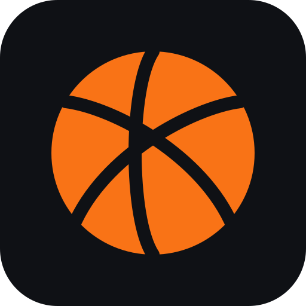
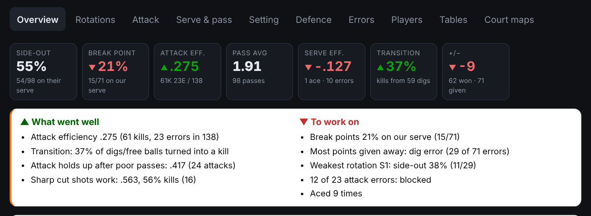
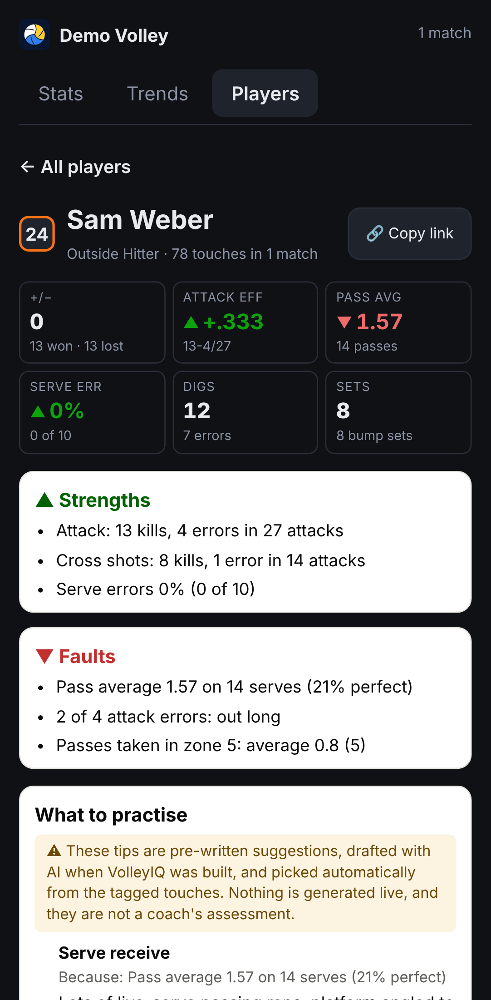
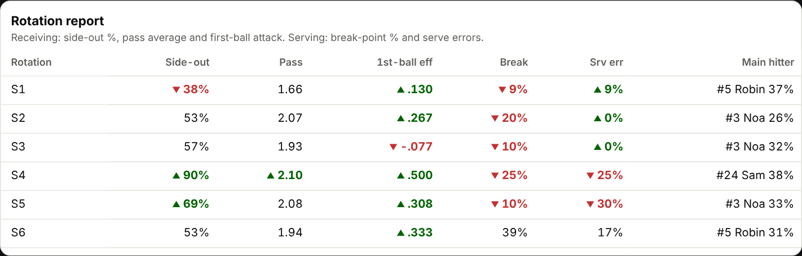
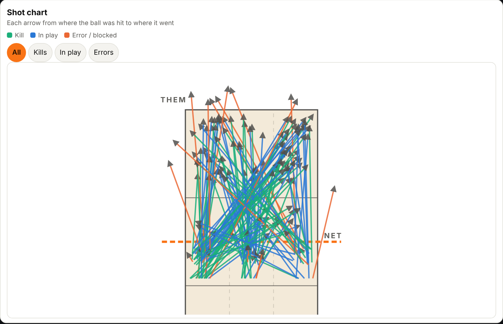

<div align="center">



# VolleyIQ

**Volleyball match tagging and analysis: tag on the phone, share the stats with a link.**

Android app · self-hosted website · Node + SQLite · on-device auto-detection

</div>

<p align="center">
  
</p>

VolleyIQ turns a match video into a coach's analysis. You tag every touch on
the phone (player, action, and two taps on the court: where the ball was
played from and where it went). The website then shows what those tags mean:
side-out and break-point %, rotations, shot charts, passing by zone, errors,
and a learning page for every player, all shared through one public link.

<table>
  <tr>
    <td width="33%"></td>
    <td width="67%">
      <br><br>
      
    </td>
  </tr>
</table>

## Contents

- [Features](#features)
- [How it fits together](#how-it-fits-together)
- [Install the Android app](#install-the-android-app)
- [Run the server](#run-the-server)
- [Optional AI features](#optional-ai-features)
- [How auto-detection works](#how-auto-detection-works)
- [Development](#development)

## Features

### Tagging (Android app)

- **Tag pad**: tap the jersey, then the action, then where the ball was played from and where it went. The likely next action comes first (pass → set → attack, dig → set → attack), the setter is picked for sets, and only attackers are offered for attacks.
- **Rally flow**: a **Serve · #7** button for the player in position 1, and **We won / They won** to close a rally (it turns the last touch into the kill, ace or error).
- **Line-up and rotation**: starting six, libero and substitutions; players on court are listed first.
- **Video**: any file on the phone or an imported link (WeTransfer, Google Drive, Dropbox, YouTube, Vimeo, …); seek buttons, 0.5–2× speed, portrait or landscape.
- **Offline**: tags are queued without a connection and synced later.
- **Match sheet scan** (optional): photograph the official score sheet to pre-fill the teams, rosters and set scores.

### Analysis (website)

| Section | What it shows |
| --- | --- |
| Overview | Side-out %, break-point %, attack and serve efficiency, pass average, transition; what went well and what to work on; set-by-set scores, scoring runs, points by rally length. |
| Rotations | Side-out, pass, first-ball attack, break point and main hitter per rotation, worked out from the serve order, no line-up needed. |
| Attack | Efficiency by phase and pass quality, shot direction (line / cross / sharp cut) and depth, where attacks were hit from (front row vs back row), kill % by target zone, shot chart. |
| Serve & pass | Servers and error types, where serves land, receivers, pass quality by zone, side-out % by pass grade. |
| Setting · Defence · Errors | Set distribution in and out of system, real assists, dig and block numbers, who gives points away and how. |
| Players | A card per player, and a **learning page** with strengths, faults and what to practise, generated from their own touches. |
| Reports | Chat-ready report images, a print-ready PDF, CSV export, leaderboards. |

Good values are marked **▲ green**, poor ones **▼ red** (only when there are enough attempts to judge).

### Sharing

One **public link** per team (no login) opens the season, every match and
every player's learning page. It updates as more matches are tagged and can be
revoked at any time. Tagging, rosters and editing stay behind the login.

## How it fits together

```
 Android app                                       Server (≈80 MB RAM)
 ┌────────────────────────────────────────┐       ┌──────────────────────────────┐
 │ videos stay on the phone                │ HTTPS │ Node (Fastify) + SQLite      │
 │ tagging, line-ups, review               │──────▶│ tags, rosters, matches       │
 │ auto-detection in the background        │       │ website: analysis + sharing  │
 │  (sound, picture, jersey OCR, on-device)│       └──────────────────────────────┘
 └────────────────────────────────────────┘
```

The server never receives video and does no heavy work. All match data lives in
one SQLite file on your server.

## Install the Android app

On your phone, open **[Releases → latest](../../releases/latest)** of this repository and tap **VolleyIQ.apk**
(or use `https://github.com/<owner>/<repo>/releases/latest/download/VolleyIQ.apk`).
Open it, and allow installing apps from your browser if Android asks. In the app,
enter your server address (e.g. `https://volleyiq.example.com`) and password.

Every push also builds a test APK, published as the pre-release **VolleyIQ Android
(latest build)**. Updates install over the old version because every build is signed
with the same key (`web/android/keystore/sideload.jks`, committed for sideloading).
Before publishing the app in a store, use a private key via the `ANDROID_KEYSTORE_*`
variables (see `web/android/app/build.gradle`).

### Making a release

Update `CHANGELOG.md`, then tag the commit on `main`:

```bash
git tag v1.1.0 && git push origin v1.1.0
```

GitHub Actions builds the APK and publishes the release **VolleyIQ v1.1.0** with it.

## Run the server

Any machine with Docker works.

```bash
git clone <this repository> volleyiq && cd volleyiq
cp .env.example .env      # set APP_PASSWORD and SESSION_SECRET (openssl rand -hex 32)
docker compose up -d --build
```

It listens on `127.0.0.1:3080` (memory limit 192 MB). Put it behind your
reverse proxy with HTTPS, for example:

<details>
<summary>nginx</summary>

```nginx
server {
    server_name volleyiq.example.com;
    listen 443 ssl;   # plus your certificate lines
    location / {
        proxy_pass http://127.0.0.1:3080;
        proxy_set_header Host $host;
        proxy_set_header X-Forwarded-Proto $scheme;
    }
}
```
</details>

<details>
<summary>Caddy</summary>

```
volleyiq.example.com {
    reverse_proxy 127.0.0.1:3080
}
```

On a host where Caddy runs as a system service, `deploy/install.sh` does all of
the above (run it from a clone; safe to re-run for updates):

```bash
sudo bash deploy/install.sh volleyiq.example.com              # install or update
sudo bash deploy/install.sh --uninstall volleyiq.example.com  # remove (database saved first)
```

It shows a plan and asks before changing anything, validates the Caddy config,
backs up the Caddyfile and the database, and only touches `/opt/volleyiq`, its
own Docker project and a marked block in the Caddyfile.
</details>

**Back up** `data/volleyiq.db`: it is the only state.

## Optional AI features

Two features are hidden unless an AI backend is configured in `.env`:

- **Match sheet scan** reads the teams, rosters and set scores off a photo of the score sheet.
- **AI touch check** (Review, with a video file): three frames per detected touch go to a vision model, which marks noise, sorts ours / theirs and fills in the action and number it is sure about, before you save the rally. At most `AI_DAILY_LIMIT` checks a day.
- **Coach summary** writes a few plain-language points (English or German) from the computed stats; it only uses the numbers it is given.

Use either an OpenAI-compatible gateway such as LiteLLM (`LITELLM_BASE_URL`,
`LITELLM_API_KEY`, `LITELLM_MODEL`) or the Anthropic API (`ANTHROPIC_API_KEY`).
See `.env.example`. After changing `.env`, recreate the container and check the
setup (lists the models your key can use and sends two tiny test requests; the key is never printed):

```bash
docker compose up -d --force-recreate
docker compose exec app node src/ai-check.js
```

## How auto-detection works

The app can pre-fill touches from the video in the background; you confirm or
fix them in Review.

1. **Sound**: ball contacts are short broadband thuds; referee whistles are long tones at 2–4.5 kHz.
2. **Picture**: edit cuts show up as a jump in frame difference; cuts and whistles bound the rallies.
3. **Rally model**: serve, then up to three touches per side, alternating sides; holes in a rally's rhythm get a `quiet` or `gap` suggestion.
4. **Vision**: an on-device detector (MediaPipe EfficientDet-Lite0) finds players and the ball, ML Kit reads the jersey number nearest the ball, and a court calibration tells our touches from theirs.

It is a head start, not a referee: it works best on a camera recording with
gym sound, readable jersey numbers (720p+) and the camera behind a baseline.
The Python package in `worker/` is the reference implementation the Kotlin code
was ported from, and doubles as a desktop CLI
(`python -m volleyiq_worker.cli match.mp4`).

## Development

```bash
cd server && npm install && npm run dev            # API on :3000 (no APP_PASSWORD = no login)
cd web && npm install && npm run dev               # UI on :5173, proxies /api to :3000
cd web && npm run build && npx cap sync android    # then build the APK with ./gradlew
```

| Tests | Command |
| --- | --- |
| Server | `cd server && npm test` |
| Web | `cd web && npm test` |
| Worker | `cd worker && python -m pytest tests` |
| Android | `./gradlew testReleaseUnitTest` (runs in CI) |
